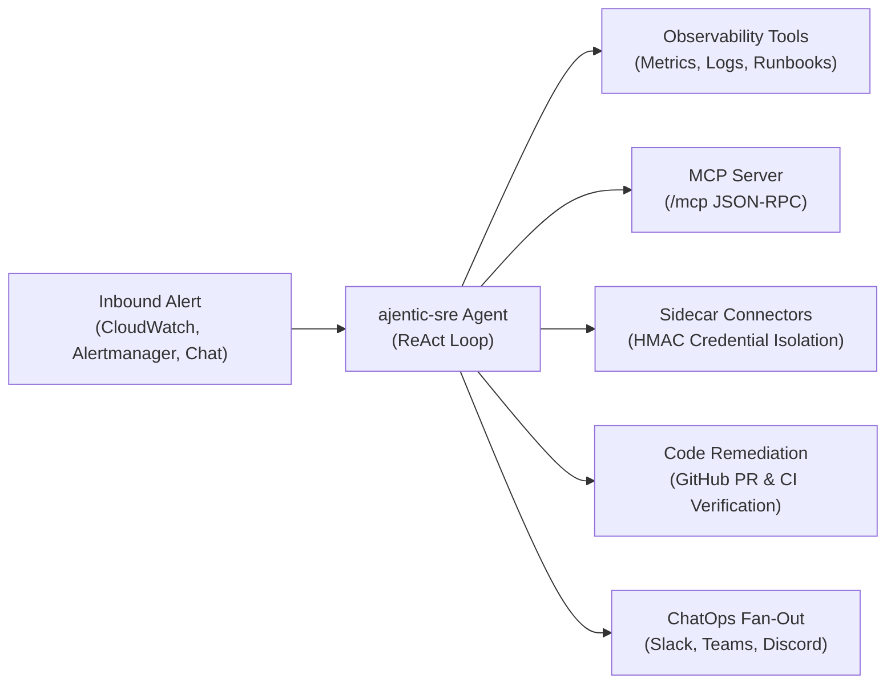
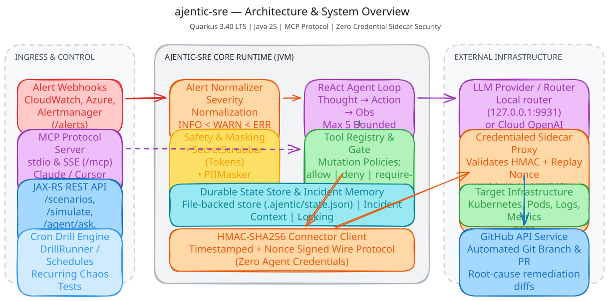

# ajentic-sre

**Practice range for autonomous AI SRE agents handling infrastructure incidents.**

`ajentic-sre` stages simulated production failures, equips AI agents with observability and remediation tools, and grades whether the agent diagnoses the root cause and restores the service.

- **Offline-First:** Runs without a live model or network; the entire 236-test suite runs offline against WireMock stubs.
- **Java 25 on Quarkus 3.40:** Modern virtual threads (`Thread.startVirtualThread`), Scoped Values, and official Quarkus LTS release.
- **HTTP-First Entrypoint:** Root `/` redirects directly to Swagger UI at `/q/swagger-ui`. Full REST API under `/api/v1`.
- **Model Context Protocol (MCP):** Native MCP server (stdio and streamable HTTP `/mcp`) for AI IDEs and agents.
- **Credential Isolation:** Sidecar connector model ensures sensitive cloud credentials never enter the reasoning agent pod.

---

## Quick Start

```bash
mise install          # JDK 27 and Maven 3.10 (per .mise.toml)
mvn quarkus:dev       # Launch dev server at http://localhost:8080 (live reload + Dev UI)
mvn test              # Run 100% offline test suite (236 tests)
```

Package and run standalone:
```bash
mvn package
java -jar target/quarkus-app/quarkus-run.jar   # Starts server on :8080
```

---

## Core Capabilities





- **ReAct Incident Engine:** Multi-turn autonomous investigation using sealed action spaces, step budgets, and reward grading.
- **Service Dependency Graph:** Validated DAG topologies with cascading failure attenuation across service dependencies.
- **Automated PR Remediation:** Ingests alerts, inspects code, commits fixes, and opens GitHub pull requests with CI validation.
- **OpenAI-Compatible Facade:** Drop-in `/v1/chat/completions` API to power Open WebUI, LibreChat, or Continue.dev.
- **Operator Approval Gates:** Human-in-the-loop authorization policy (`require-approval`) for mutating operational changes.

> **Excalidraw Diagrams:** Visual architecture diagrams are maintained in [`docs/diagrams/`](docs/diagrams/):
> - [System Architecture Overview](docs/diagrams/system-overview.svg) ([`.excalidraw`](docs/diagrams/system-overview.excalidraw), [`.png`](docs/diagrams/system-overview.png))
> - [Incident Remediation ReAct Loop](docs/diagrams/incident-react-loop.svg) ([`.excalidraw`](docs/diagrams/incident-react-loop.excalidraw), [`.png`](docs/diagrams/incident-react-loop.png))
> - [Credential-Isolated Sidecar Model](docs/diagrams/sidecar-security-model.svg) ([`.excalidraw`](docs/diagrams/sidecar-security-model.excalidraw), [`.png`](docs/diagrams/sidecar-security-model.png))

---

## Documentation Index

Detailed documentation is organized into topic-specific guides:

| Guide | Description |
|---|---|
| [**01. Architecture & Incident Simulation**](docs/01-architecture.md) | Simulation lifecycle, ReAct reasoning loop, incident scorecards, and scenario DAG topologies. |
| [**02. HTTP API & Cookbook**](docs/02-http-api.md) | Complete REST endpoint reference, OpenAPI/Swagger discovery, and cURL recipes for simulation & SSE chat. |
| [**03. Model Context Protocol (MCP)**](docs/03-mcp.md) | Quarkiverse MCP server setup, stdio and streamable HTTP transports, tool catalogs, resources, and prompts. |
| [**04. ChatOps & OpenAI Facade**](docs/04-chatops-and-facade.md) | Outbound notification fan-out (Slack, Teams, Discord), inbound chat commands, and OpenAI `/v1` compatibility. |
| [**05. Alerts & Automated Remediation**](docs/05-alerts-and-remediation.md) | Ingestion of Alertmanager/CloudWatch/Azure alerts, severity gating, and autonomous GitHub PR creation. |
| [**06. Sidecar & Security Connectors**](docs/06-sidecar-and-security.md) | Credential isolation, HMAC-SHA256 signing, anti-replay nonce caching, and mutating audit logs. |
| [**07. Schedules & State Persistence**](docs/07-schedules-and-state.md) | 5-field cron disaster drills, atomic `.ajentic/state.json` persistence, episodic memory, and approval gates. |
| [**08. LLM Providers & Masking**](docs/08-llm-and-masking.md) | OpenAI-compatible endpoints, ordered failover routing, and PII/secret sensitive data masking interceptors. |
| [**09. Deployment & Operations**](docs/09-deployment-and-operations.md) | Container builds, Kubernetes/Helm manifests, and the local observability lab (Prometheus + Grafana). |
| [**10. Testing & Extensibility**](docs/10-testing-and-extensibility.md) | Offline WireMock test suite, Pact consumer contracts, and authoring external YAML/JSON scenario packs. |

---

## Project Layout

```
io.ajentic.sre
├── simulation          # Scenario library, environment contracts, incident scorecards, drills, and playbooks
├── agent
│   ├── alerts          # Multi-cloud alert normalizer and automated remediation
│   ├── context         # Java 25 ScopedValue execution context for virtual threads
│   ├── github          # Resilient GitHub REST client (zero git clone)
│   ├── integration     # Chat channels (Slack, Teams, Discord) and sidecar client
│   ├── llm             # LangChain4j model integration and endpoint failover
│   ├── masking         # Sensitive data masking and unmasking interceptors
│   ├── mcp             # Quarkiverse MCP resources and prompt templates
│   ├── memory          # Incident memory store and past context retrieval
│   ├── session         # ReAct session state, conversation history, and transcript
│   └── tool            # Tool contract, CDI toolboxes, built-in investigation tools
├── connectors          # Credential-isolated sidecar security (HMAC-SHA256) and audit logging
├── schedule            # 5-field cron engine, versioned store, and drill runner
├── state               # File-backed durable state store (.ajentic/state.json) and concurrency locks
├── benchmark           # Dev-only benchmark runner and performance profiler (-Pbenchmark)
├── api                 # JAX-RS resources, SSE event sinks, and OpenAI facade
└── health              # SmallRye health liveness and readiness checks
```

---

## Toolchain & Versions

- **Runtime:** Java 25 (`--release 25`), optional Java 27 Preview (`-Pjdk27-preview`).
- **Framework:** Quarkus `3.40.1.1`.
- **MCP Server:** `io.quarkiverse.mcp:quarkus-mcp-server-*` `2.0.4`.
- **LangChain4j:** `io.quarkiverse.langchain4j:quarkus-langchain4j-*` `1.14.2`.
- **Build Tool:** Apache Maven 3.10+ (via `mise`).
