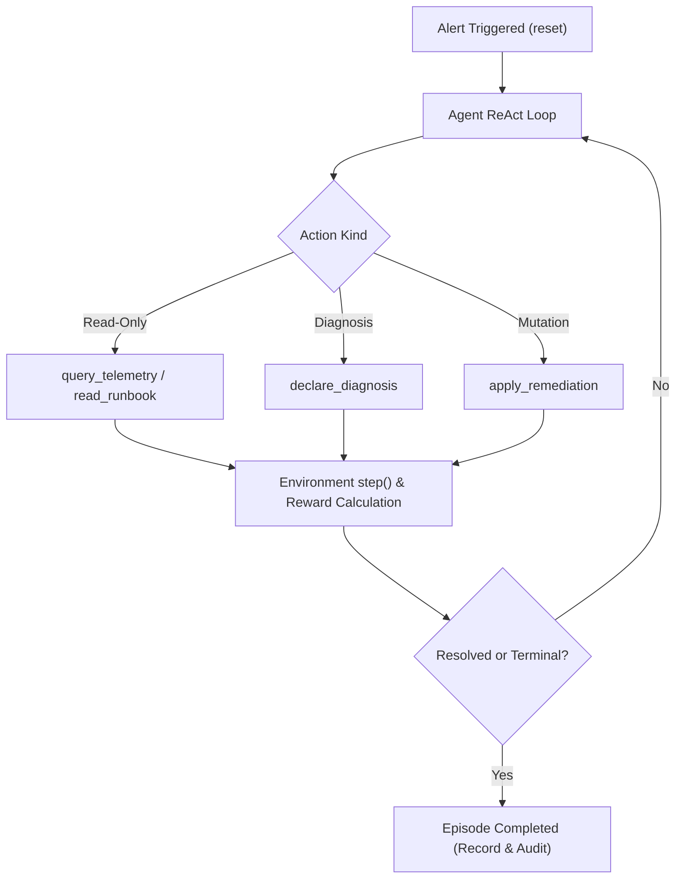

[← Back to README](../README.md) | **Next:** [02 - HTTP API & Cookbook →](02-http-api.md)

---

# Architecture & Reinforcement Learning Model

`ajentic-sre` models infrastructure incident triage and remediation as a reinforcement learning (RL) environment driven by a ReAct (Reasoning + Acting) loop.

## The Incident Loop

An episode represents a single incident. A scenario defines the failure condition, and the environment exposes the resulting system symptoms. The agent acts sequentially until the incident is resolved, its budget is exhausted, or it triggers an unrecoverable failure:

1. **`reset()`**: St解读ages the scenario failure, seeds initial telemetry, and returns the alert and available action space.
2. **Investigation**: The agent executes read-only tools (`query_telemetry`, `read_runbook`, `list_remediations`, `correlate_anomalies`).
3. **Diagnosis & Remediation**: The agent records root causes via `declare_diagnosis` and executes mitigation via `apply_remediation`.
4. **`step()`**: Evaluates the transition, applies state changes, calculates reward, and checks termination conditions.
5. **Outcome**: The episode terminates with flags for `solved`, `resolved`, and `diagnosed`, alongside cumulative reward and step trajectory.

## RL Interface Components

| Type | Responsibility |
|---|---|
| `Environment` | Contract for `reset()`, `step()`, `observe()`, `spec()`, and terminal state queries |
| `Observation` | Encapsulates active incident, telemetry snapshot, service health, and available action space |
| `AgentAction` | Sealed action hierarchy: telemetry queries, runbook lookup, remediation, diagnosis, idle |
| `StepResult` | Returns next observation, step reward, and termination status |
| `RewardFunction` | Evaluates transitions into scalar rewards (credits correct fix, charges step cost, penalizes mistakes) |
| `Policy` | Strategy choosing actions from observations (heuristic, random, or LLM-driven) |
| `EpisodeRunner` | Manages episode lifecycle and compiles `EpisodeResult` |

## Built-in Scenarios

| Scenario | Root Cause | Correct Remediation | Target Service |
|---|---|---|---|
| `checkout-latency-db-pool` | Database connection pool exhaustion | `SCALE_UP` | `checkout-api` |
| `payments-memory-leak` | Application heap memory leak | `RESTART` | `payments-api` |
| `auth-certificate-expiry` | Expired TLS certificate | `FIX_CONFIG` | `auth-service` |
| `search-dns-failure` | Cluster DNS resolution failure | `FAILOVER` | `search-api` |
| `orders-bad-deployment` | Faulty application release deployment | `ROLLBACK_DEPLOY` | `orders-api` |
| `storage-disk-pressure` | Node persistent volume exhaustion | `EXPAND_DISK` | `storage-node` |

## Dependency Graph & Cascade Topology

Services declare upstream and downstream dependencies forming a directed acyclic graph (DAG). The graph is validated at startup to eliminate cycles and dangling references.

When a fault occurs on a dependency:
- Upstream callers experience cascading latency and error degradation.
- Severity attenuates by a factor of `0.5` per graph edge.
- Telemetry across metrics, logs, and traces remains mathematically consistent.

---

[← Back to README](../README.md) | **Next:** [02 - HTTP API & Cookbook →](02-http-api.md)
