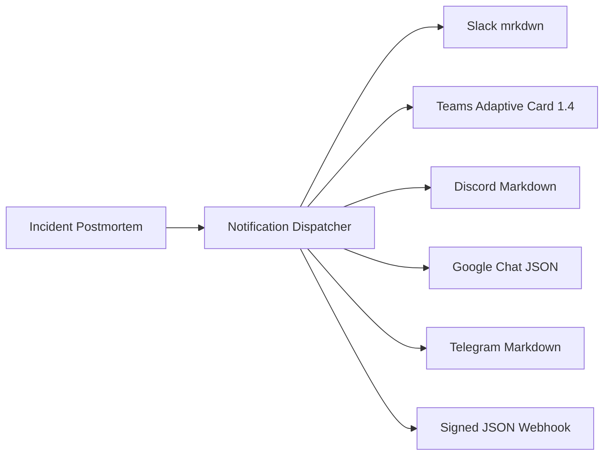

[← Back to README](../README.md) | [← Previous: MCP Server Protocol](03-mcp.md) | **Next:** [05 - Alerts & Automated Remediation →](05-alerts-and-remediation.md)

---

# ChatOps Integration & OpenAI API Facade

`ajentic-sre` integrates directly with team communication channels and exposes a drop-in **OpenAI-compatible API facade** for web interfaces (e.g. Open WebUI, LibreChat, Continue.dev).

## Outbound Notification Fan-Out

Incident updates and postmortems fan out asynchronously to configured chat providers on Java 25 virtual threads.

Configured via `ajentic.notifications.channel` (comma-separated): `log,slack,teams,google-chat,discord,telegram,mattermost,webhook`.

### Channel Providers & Configuration

| Provider | Key Configuration | Formatting Output |
|---|---|---|
| **Slack** | `ajentic.notifications.slack.webhook-url` `ajentic.notifications.slack.token` | Native Slack `mrkdwn` blocks |
| **Microsoft Teams** | `ajentic.notifications.teams.webhook-url` | Adaptive Cards 1.4 schema |
| **Google Chat** | `ajentic.notifications.google-chat.webhook-url` | Google Chat card & text payload |
| **Discord** | `ajentic.notifications.discord.webhook-url` | Discord rich markdown |
| **Telegram** | `ajentic.notifications.telegram.bot-token` `ajentic.notifications.telegram.chat-id` | Telegram HTML/Markdown |
| **Mattermost** | `ajentic.notifications.mattermost.webhook-url` | Mattermost markdown webhook |
| **Generic Webhook** | `ajentic.notifications.webhook.url` `ajentic.notifications.webhook.secret` | HMAC-SHA256 signed JSON payload |

### Outbound Resilience
- **Exponential Backoff:** Retries with randomized jitter (`ajentic.notifications.max-retries=3`).
- **Circuit Breaker:** Opens after successive failures (`ajentic.notifications.circuit-breaker-threshold=5`) to avoid cascading load.
- **Rate Limiting:** Token-bucket limiter restricts dispatch rates (`ajentic.notifications.rate-limit-per-second=10.0`).

---

## Inbound Chat Commands

Inbound chat webhooks arrive at `POST /api/v1/webhooks/chat/{provider}` (`slack`, `teams`, `google-chat`, `discord`, `telegram`, `generic`).

- **Signature Verification:** Slack HMAC (`X-Slack-Signature` with 300s window), Twilio (`X-Twilio-Signature`), and Google JWT bearer tokens.
- **Deduplication:** Event IDs (`event_id`, `trigger_id`, `update_id`) are cached to prevent repeat agent invocations.
- **Supported Commands:**
  - `ask <question>`: Runs an autonomous ReAct investigation turn and returns the answer.
  - `status <episode|repo>`: Returns current episode health or GitHub PR status.
  - `fix <repo> <trace>`: Triggers automated code remediation against the specified repository.
  - `approve <id>` / `deny <id>`: Acts on pending mutating tool calls gated by operator approval.

---

## OpenAI-Compatible API Facade

Any client expecting OpenAI's `/v1` protocol can target `ajentic-sre` directly:

- `GET /v1/models`: Returns the configured SRE reasoning model.
- `POST /v1/chat/completions`: Supports both streaming (`stream: true`) and non-streaming responses.
- Optional API Key: Gated by `ajentic.chat.api-key` (Bearer token).

### Using with Open WebUI / LibreChat

1. In Open WebUI, navigate to **Settings -> Connections -> OpenAI API**.
2. Set **URL** to `http://localhost:8080/v1`.
3. Set **API Key** to your `ajentic.chat.api-key` (or leave empty if unconfigured).
4. Select the model and chat. Incoming prompts trigger autonomous ReAct investigation turns with streamed thinking and answers.

---

[← Back to README](../README.md) | [← Previous: MCP Server Protocol](03-mcp.md) | **Next:** [05 - Alerts & Automated Remediation →](05-alerts-and-remediation.md)
