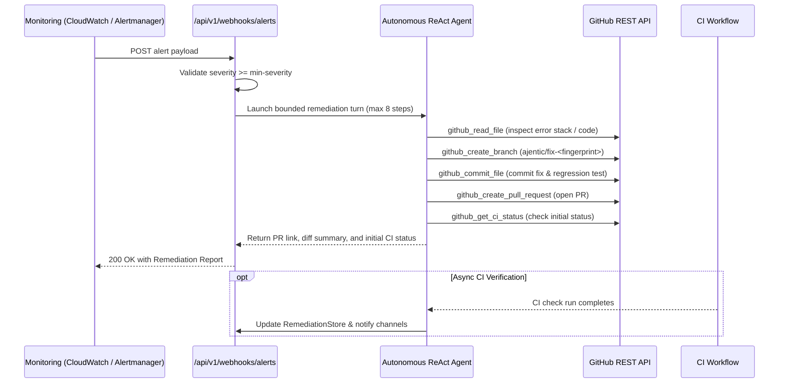

[← Back to README](../README.md) | [← Previous: ChatOps & OpenAI Facade](04-chatops-and-facade.md) | **Next:** [06 - Sidecar & Security Connectors →](06-sidecar-and-security.md)

---

# Alert Webhooks & Automated Code Remediation

`ajentic-sre` ingests infrastructure alerts from multiple monitoring providers, filters them by severity threshold, and autonomously performs code remediation turns by opening branches, committing fixes, and opening pull requests on GitHub.

## Supported Inbound Alert Protocols

Alerts are ingested at `POST /api/v1/webhooks/alerts` (unified multi-cloud endpoint) or dedicated intake endpoints:

- `POST /api/v1/webhooks/alertmanager`
- `POST /api/v1/webhooks/pagerduty`
- `POST /api/v1/webhooks/cloudwatch-sns`

### Severity Gating

Inbound alerts are normalized to standard severity levels:
$$\text{INFO} < \text{WARNING} < \text{ERROR} < \text{CRITICAL}$$

Configured by `ajentic.alerts.min-severity` (default `ERROR`):
- **`202 Accepted` (`status = "IGNORED"`):** Alert severity is below threshold or no target repository is defined. Zero LLM calls are made.
- **`200 OK` (`status = "PROCESSED"`):** Alert meets criteria; triggers a bounded one-shot remediation turn.

---

## Automated GitHub Remediation Flow



### GitHub Tools

| Tool | Capability | Description |
|---|---|---|
| `github_list_files` | READ | Lists repository directory contents recursively |
| `github_read_file` | READ | Reads source file contents at a specific commit ref or branch |
| `github_get_ci_status` | READ | Queries GitHub Actions workflow runs and check-runs |
| `github_create_branch` | MUTATE | Branches target repository from base branch |
| `github_commit_file` | MUTATE | Creates or updates files via GitHub REST API without local git clone |
| `github_create_pull_request` | MUTATE | Opens pull request with descriptive title, explanation, and issue link |
| `github_trigger_workflow` | MUTATE | Dispatches workflow runs via `workflow_dispatch` |

### Configuration Properties

```properties
# GitHub Authentication & Defaults
ajentic.github.base-url=https://api.github.com
ajentic.github.token=ghp_yourPersonalAccessToken
ajentic.github.default-repo=acme/checkout-service
ajentic.github.timeout=30s

# Asynchronous CI Polling
ajentic.github.ci.poll-attempts=6
ajentic.github.ci.poll-interval=10s
ajentic.github.ci.trigger-workflows=true
```

When `ajentic.github.token` is left blank, mutating actions gracefully return error messages and the agent provides code analysis without failing or crashing.

---

[← Back to README](../README.md) | [← Previous: ChatOps & OpenAI Facade](04-chatops-and-facade.md) | **Next:** [06 - Sidecar & Security Connectors →](06-sidecar-and-security.md)
