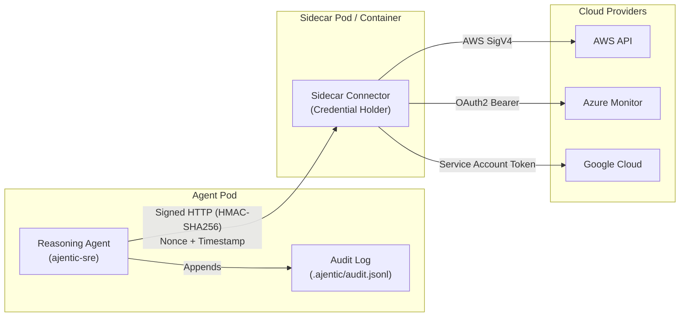

[← Back to README](../README.md) | [← Previous: Alerts & Automated Remediation](05-alerts-and-remediation.md) | **Next:** [07 - Schedules & State Persistence →](07-schedules-and-state.md)

---

# Sidecar Connectors & Credential Isolation

To prevent prompt injection attacks or rogue agent behavior from compromising cloud credentials, `ajentic-sre` implements a **credential-isolated sidecar connector architecture**.

## Security Guarantees

1. **Zero Secret Exposure to Reasoning Agent:**
   The agent container does not receive or store cloud credentials (AWS secret keys, Azure client secrets, GCP service accounts) or chat tokens.
2. **HMAC-SHA256 Mutual Authentication:**
   All communication between the agent and sidecar connector is authenticated with HMAC-SHA256 using a shared secret (`ajentic.sidecar.secret`).
3. **Anti-Replay Defense:**
   Requests must include a timestamp within a 5-minute validity window and a unique nonce cached by the receiver. Stale or replayed requests return `401 Unauthorized`.
4. **Fail-Closed Resilience:**
   If the sidecar connector is unreachable or unhealthy, mutating tool calls fail closed with a clean `503 Service Unavailable` error instead of crashing.
5. **Immutable Mutation Audit Logging:**
   Every mutating remediation call records an entry to `.ajentic/audit.jsonl` recording timestamp, actor, action, target resource, and outcome.

## Secret Placement Matrix

| Credential | Held by Agent? | Held by Sidecar Connectors? |
|---|:---:|:---:|
| AWS Credentials (`AJENTIC_AWS_ACCESS_KEY_ID`, etc.) | ❌ No | ✅ Yes |
| Azure Client Secret (`AJENTIC_AZURE_CLIENT_SECRET`) | ❌ No | ✅ Yes |
| GCP Service Account Private Key | ❌ No | ✅ Yes |
| Slack / Discord Webhook URLs | ❌ No | ✅ Yes |
| Sidecar Shared Secret (`ajentic.sidecar.secret`) | ✅ Yes | ✅ Yes |
| Local LLM Router URL | ✅ Yes | ❌ No |

## Kubernetes Deployment Manifests

Production manifests are located in `deploy/`:
- `deploy/deployment.yaml`: Configures the agent container alongside the sidecar connector pod.
- `deploy/service.yaml`: Internal cluster service discovery.
- `deploy/networkpolicy.yaml`: Restricts egress from the agent pod exclusively to the local sidecar.
- `deploy/helm-values.yaml`: Template values for Helm packaging.

---

[← Back to README](../README.md) | [← Previous: Alerts & Automated Remediation](05-alerts-and-remediation.md) | **Next:** [07 - Schedules & State Persistence →](07-schedules-and-state.md)
