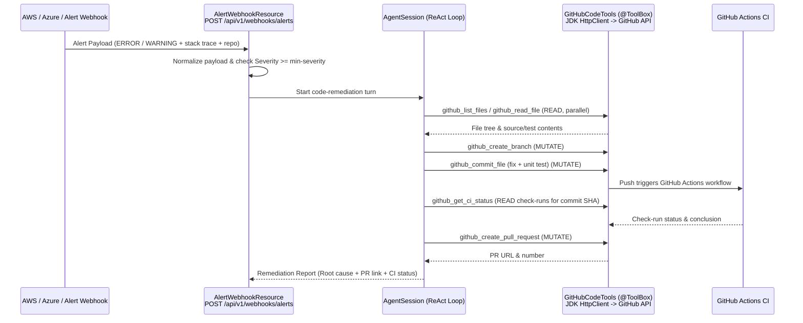

# ajentic-sre implementation plan

Branch-per-workstream plan for the three tracks. Every branch is independently mergeable, keeps the default test
suite offline (`mvn test`, WireMock stubs, no model, no network), and targets Java 25 / Quarkus 4.0.0.Beta1.

## Branch map and merge order

| # | Branch | Track | Scope | Depends on | Status |
|---|--------|-------|-------|------------|--------|
| 1 | `fix/masking-multiturn-toolcalls` | 1 | Mask prior-turn `toolCalls`; scope masking per session | — | ✅ done |
| 2 | `fix/tool-step-terminal-semantics` | 1 | Read tools through `Environment.step`; terminal only when solved | — | ✅ done |
| 3 | `feat/symptom-first-alerts` | 1 | Unspoiled initial observation | 2 | ✅ done |
| 4 | `fix/cli-mcp-stdio-isolation` | 1 | No `:8080` bind for CLI/MCP; clean stdout | — | ✅ done |
| 5 | `fix/episode-cursor-scoping` | 1 | Per-session/request episode targeting | 4 | ✅ done |
| 6 | `refactor/schedule-scenario-reference` | 1 | Store `scenarioId`, not a lambda; race-free `run` | — | ✅ done |
| 7 | `feat/prometheus-episode-metrics` | 1 | Micrometer counters/timers for episodes, tools, tokens | 2 | ✅ done |
| 8 | `feat/local-docker-stack` | 1 | `docker-compose.yml`: app + Prometheus + Grafana | 7 | ✅ done |
| 9 | `feat/scenario-packs` | 2 | External YAML/JSON scenario loading | 3 | ✅ done |
| 10 | `feat/topology-cascading-failures` | 2 | Service DAG + downstream→upstream degradation | 3, 9 | ✅ done |
| 11 | `feat/investigation-tools` | 2 | `inspect_recent_changes`, `correlate_anomalies`, topology tool | 10 | ✅ done |
| 12 | `feat/stagnation-breaker` | 2 | Duplicate tool-call detection with synthetic hint | 2 | ✅ done |
| 13 | `feat/token-usage-budget` | 2 | Cumulative usage in `Conversation`/`ChatResponse` | — | ✅ done |
| 14 | `feat/llm-policy-adapter` | 2 | `@PolicyModel(LLM)` ReAct policy | 2, 13 | ✅ done |
| 15 | `feat/benchmark-cli` | 2 | `benchmark` subcommand + scorecard | 14 | ✅ done |
| 16 | `feat/environment-backends` | 3 | `ajentic.environment.backend` strategy | 6, 10 | ✅ done |
| 17 | `feat/live-telemetry-adapters` | 3 | `local-container` / `cloud-live` read-only adapters | 16 | ✅ done |
| 18 | `feat/sse-chat-stream` | 3 | `/chat/stream` SSE | 13 | ✅ done |
| 19 | `feat/alert-webhooks` | 3 | Alertmanager/PagerDuty/SNS intake | 16, 18 | ✅ done |
| 20 | `feat/llm-fallback-router` | 3 | Local-first composite LLM client | 13 | ✅ done |
| 21 | `feat/multicloud-identifier-masking` | 3 | GCP/Azure/K8s/Bearer categories | 1 | ✅ done |
| 22 | `feat/approval-gates` | 3 | `ALLOW \| DENY \| REQUIRE_APPROVAL` | 18 | ✅ done |
| 23 | `feat/episodic-memory` | 3 | `search_past_incidents` + `.ajentic/incidents.jsonl` | 6, 22 | ✅ done |
| 24 | `feat/file-state-store` | 3 | Durable schedules/drills/episodes | 6 | ✅ done |
| 25 | `feat/swagger-openapi-first` | 3 | Always-on Swagger UI + OpenAPI annotations + one-shot ask/simulate; CLI narrowed to open Swagger | — | ✅ done |
| 26 | `feat/github-code-tools` | 4 | Zero-clone GitHub REST client + `@ToolBox` code tools + PAT masking | 25 | ✅ done |
| 27 | `feat/alert-webhook-code-fix` | 4 | Multi-cloud alert normalizer + `POST /webhooks/alerts` code-fix turn | 26 | ✅ done |
| 28 | `feat/ci-feedback-loop` | 4 | Non-blocking CI status/PR follow-up + remediation report | 27 | ✅ done |
| 29 | `feat/chatops-channels` | 5 | Slack/Teams/Google Chat/Discord/Telegram + OpenAI-compatible chat API | 19, 22 | ✅ done |
| 30 | `feat/cloud-provider-adapters` | 5 | AWS / Azure / GCP read-only adapters (SigV4, OAuth2, SA-JWT), zero SDK | 17, 21 | ✅ done |
| 31 | `feat/local-cloud-emulation` | 5 | LocalStack + Azurite + fake-gcs/PubSub + monitor stubs in compose | 30 | ✅ done |
| 32 | `feat/sidecar-connectors` | 5 | Connectors as a least-privilege sidecar next to the agent | 29, 31 | ✅ done |
| 33 | `refactor/http-only-surface` | 5 | Drop picocli entirely; Swagger/HTTP only (+ MCP stdio shim) | 25, 32 | ✅ done |
| 34 | `feat/langchain4j-mcp-migration` | 6 | Replace custom MCP/LLM/tool-schema with quarkus-mcp-server + quarkus-langchain4j | 25 | ✅ done |

Recommended landing order: 1 → 2 → 4 → 5 → 6 → 3 → 13 → 12 → 21 → 7 → 8 → 9 → 10 → 11 → 14 → 15 → 16 → 17 → 18 →
19 → 20 → 22 → 23 → 24 → 26 → 27 → 28 → 29 → 30 → 31 → 32 → 33 → 34. Branches 1, 2, 4, 6, 13 are independent and can
be opened in parallel. Track 5 lands after Track 4 and ends by deleting the CLI (33), so no branch may add a new
picocli subcommand. Track 6 (34) lands last: it rewrites the MCP, LLM, and tool-schema plumbing that every other
branch builds on, so it is done after the feature branches so their tests stay stable until the migration rewrites them.

Conventions for every branch:
- `git switch -c <branch> main`; conventional commits (`fix:`, `feat:`, `refactor:`, `test:`, `docs:`).
- New config keys go in `src/main/resources/application.properties` with a `%test` override where needed.
- Every behavior change gets an `@QuarkusTest` or plain JUnit test; live-LLM paths stay behind `-Plive-llm`.
- Update `README.md` command/API tables when a command, endpoint, or config key is added.
- `mvn verify` (offline) must pass before merge.

---

## Track 1 — Local-first polish and core fixes

### 1. `fix/masking-multiturn-toolcalls`

**Problem.** `SensitiveDataMaskingInterceptor.maskRequest` masks `content()` but passes `message.toolCalls()`
through untouched. The assistant message stored in `Conversation` has real identifiers inside tool-call arguments
because `unmaskResponse` restores them. On turn N+1 those arguments are replayed to the provider in the clear.
A fresh `MaskingSession` per LLM call also means placeholders are not stable across one agent loop.

- [x] Mask `ToolCall.arguments()` in `maskRequest` (recursively for nested maps/lists, not only top-level strings).
- [x] Preserve non-string scalars so tool schemas keep their types, with a recursion depth guard.
- [x] Scope one `MaskingSession` per `AgentSession`: create it in `AgentSessionFactory`, bind it in `chat` via
      `AgentExecutionContext.MASKING_SESSION`, and have the interceptor reuse the bound session instead of creating
      a new one per call. Keep the per-call fallback for direct `LlmClient` use.
- [x] Ensure `unmaskResponse` covers `content()` and nested `toolCalls().arguments()`; tool-call ids stay verbatim.
- [x] E2E test: a two-turn session whose first tool call carries an IPv4, an AWS ARN, and an email; every outbound
      WireMock body is free of the originals and reuses `[[IP_1]]` (no `[[IP_2]]`).
- [x] E2E test: nested map/list tool-call arguments are masked before they reach the provider.

**Files.** `agent/masking/SensitiveDataMaskingInterceptor.java`, `agent/masking/MaskingSession.java`,
`agent/session/AgentSession.java`, `agent/session/AgentSessionFactory.java`, `agent/llm/MaskingLlmClient.java`,
`src/test/resources/wiremock/*`.

**Done when.** A grep of recorded outbound requests for a known secret returns zero hits across all turns, and the
masking tests fail on `main` but pass on the branch.

### 2. `fix/tool-step-terminal-semantics`

**Problem.** `query_telemetry`, `read_runbook`, and `list_remediations` call `environment.signals(...)` /
scenario data directly, so read actions never advance `system.tick()` and never incur the step penalty in
`IncidentRewardFunction` (`STEP_COST = -0.02` in the current code, not `-0.05`). Separately
`SimulatedProductionEnvironment.step` sets terminal `RESOLVED` as soon as
`allFaultsResolved()`, even when `diagnosed == false`, so remediation-before-diagnosis ends the episode unsolved.

- [x] Route read tools through `context.environment().step(new QueryTelemetry(...))`, `new ReadRunbook(...)`,
      `new ListRemediations()`; return `result.observation()` content rather than re-querying the environment.
- [x] Return results from `StepResult.observation()` so read tools never bypass `Environment.step`.
- [x] Change terminal logic: `allFaultsResolved()` alone is not `RESOLVED`; require `diagnosed && allFaultsResolved()`.
      Keep `CATASTROPHIC` and `MAX_STEPS` unchanged.
- [x] Keep a remediated-but-undiagnosed episode open so the agent can still declare the root cause.
- [x] Test: parallel read tools increment `step` to 9 instead of leaving the clock at 0.
- [x] Test: `apply_remediation` before `declare_diagnosis` leaves the episode open; the later diagnosis terminates it
      with `diagnosed` and `resolved` both true.
- [x] Test: heuristic policy still reaches `RESOLVED` for every bundled scenario.

**Files.** `agent/tool/builtin/BuiltInSreTools.java`, `rl/simulation/SimulatedProductionEnvironment.java`,
`rl/Observation.java` (if needed), `rl/policy/HeuristicPolicy.java` (if ordering changes),
`src/test/java/io/ajentic/sre/rl/IncidentResponseEndToEndTest.java`.

### 3. `feat/symptom-first-alerts`

**Problem.** `reset(...)` seeds `"Incident detected on " + scenario.culpritService()` and pre-populates signals for
the culprit, so `HeuristicPolicy.resolveTarget` and the LLM are handed the answer.

- [x] Change the initial observation to a symptom on the entry/edge service (e.g. `edge-gateway` or
      `checkout-api` 5xx spike), with no mention of the culprit.
- [x] Seed the initial observation with signals for the alarming service only.
- [x] Update `HeuristicPolicy` to start from the alerting service and scan the remaining services when the first
      one yields no diagnosis.
- [x] Add `Scenario.alertingService()` (defaulting to the first edge-kind service) so scenarios can declare it.
- [x] Test: initial observation text never contains `culpritService()`; a "lazy" policy that reads only the alert
      service cannot solve without further queries.
- [x] Test: the heuristic still solves every bundled scenario after the extra scanning steps.

**Files.** `rl/simulation/SimulatedProductionEnvironment.java`, `rl/simulation/Scenario.java`,
`rl/simulation/ScenarioLibrary.java`, `rl/policy/HeuristicPolicy.java`.

### 4. `fix/cli-mcp-stdio-isolation`

**Problem.** `java -jar .../quarkus-run.jar mcp` (and `ask`, `scenarios`, `simulate`) boots the full HTTP stack and
collides with `serve` on `:8080`; Quarkus logs/banner on stdout corrupt the MCP JSON-RPC stream.

- [x] Add `CliMain` (`@QuarkusMain`) that disables the HTTP listener for every command except `serve`, while a
      bare `java -jar` still starts the server.
- [x] Send logs to stderr and disable the banner so stdout stays clean.
- [x] Reuse the single CDI `McpProtocolHandler` in the stdio command (no second registry).
- [x] Verify manually: server on `:8080`, then `scenarios` and `mcp` run concurrently; stdout of `mcp` parses as
      JSON-RPC on every line.
- [x] Test (`CliEndToEndTest`): headless detection plus the `@QuarkusMainTest` launches for `scenarios`, `simulate`,
      and `schedules`.
- [x] Document the two-process workflow in `README.md`.

**Files.** `cli/AjenticCommand.java`, `cli/McpStdioCommand.java`, `cli/ServeCommand.java`,
`src/main/resources/application.properties`, `src/main/docker/Dockerfile.jvm`.

### 5. `fix/episode-cursor-scoping`

**Problem.** `EpisodeCursor` is one `@ApplicationScoped AtomicReference<String>`; concurrent MCP/HTTP clients
overwrite each other's active episode unless every call passes `_episodeId`.

- [x] Replace the global cursor with a per-caller strategy: explicit `_episodeId` wins, else an MCP session
      (`Mcp-Session-Id`) or agent-session scoped cursor.
- [x] Bound the cursor map (Caffeine, 1024 entries) so long-lived servers cannot leak session ids.
- [x] Brand-new MCP sessions start from `ajentic.mcp.default-scenario`, as before.
- [x] Test: two interleaved MCP sessions start different scenarios and each resolves its own episode without
      `_episodeId`.
- [x] HTTP transport returns and accepts `Mcp-Session-Id` so spec-compliant clients keep their scope.

**Files.** `rl/episode/EpisodeCursor.java`, `agent/mcp/McpProtocolHandler.java`, `agent/tool/builtin/BuiltInSreTools.java`,
`agent/session/*`.

### 6. `refactor/schedule-scenario-reference`

**Problem.** `ScheduleDefinition` holds an in-memory `ScheduledJob` closure and `ScheduleResource.run` reads
`drills.recent().getLast()` after `runNow(id)`, which is racy under concurrent drills.

- [x] Replace `ScheduledJob job` with `String scenarioId` in `ScheduleDefinition`; build the job from the stored
      id via `IncidentDrillRunner`.
- [x] Make `Scheduler.runNow(id)` return the produced `EpisodeResult`, so `ScheduleResource` no longer reads
      `drills.recent().getLast()`.
- [x] Keep the store serializable: only ids, cron, flags, zone, version, group, scenario id.
- [x] Preserve version/optimistic-lock behavior in `InMemoryScheduleStore`.
- [x] Keep in-memory lambda schedules for tests via a transient side map, so `SchedulerEndToEndTest` stays intact.
- [x] Test: existing scheduler and API suites pass, including create → run → `solved=true` for the scheduled
      scenario.

**Files.** `schedule/store/ScheduleDefinition.java`, `schedule/store/InMemoryScheduleStore.java`,
`schedule/engine/Scheduler.java`, `schedule/drill/IncidentDrillRunner.java`,
`api/resource/ScheduleResource.java`, `api/payload/ScheduleView.java`.

### 7. `feat/prometheus-episode-metrics`

- [x] Report `ajentic.episodes.started`, `ajentic.episodes.finished{solved}` (the solved/unresolved split replaces a
      separate `episodes.solved` counter), `ajentic.episode.reward`, `ajentic.episode.steps`,
      `ajentic.tool.invocations{tool,capability}`, `ajentic.tool.latency{tool}`, and `ajentic.llm.tokens{kind,model}`.
- [x] Instrument `EpisodeService` and `AgentSession` (tool invocation and every LLM response); tags are scenario id,
      tool name, capability, and the configured model, all bounded configuration values.
- [x] Expose `/q/metrics` (already served by the Prometheus registry) and assert the metric names through the API.
- [x] No `Dockerfile.jvm` change needed; the endpoint is served by the existing build.

**Files.** new `metrics/` package (or `health/`), `rl/episode/EpisodeService.java`, `agent/session/AgentSession.java`,
`agent/llm/OpenAiCompatibleLlmClient.java`.

### 8. `feat/local-docker-stack`

- [x] Add `docker-compose.yml`: `ajentic-sre` (port 8080, `AJENTIC_LLM_BASE_URL` defaulting to
      `http://host.docker.internal:9931/v1`), `prometheus` scraping `/q/metrics`, and `grafana` with a provisioned
      dashboard. Ollama and LocalStack are left out until a branch needs them.
- [x] Use `extra_hosts: host.docker.internal:host-gateway` for Linux.
- [x] Add the Grafana dashboard JSON (episodes, reward, tool p95, tokens) and the Prometheus scrape config.
- [x] Add `make lab-up` / `make lab-down`; `make test` stays offline.
- [x] Document the stack and ports in `README.md`; validate with `docker compose config`.

**Files.** `docker-compose.yml`, `src/main/docker/` (prometheus, grafana), `Makefile`, `README.md`.

---

## Track 2 — Deeper SRE simulation and model benchmarking

### 9. `feat/scenario-packs`

- [x] Add `ajentic.scenarios.dir` (empty = disabled) to `ScenarioLibrary`; load `*.yaml`, `*.yml`, `*.json`.
- [x] Define a stable external schema mirroring `Scenario`, `ServiceSpec`, `Fault`, `Runbook`; validate on load and
      fail fast with file context.
- [x] Merge external packs with built-ins; external ids may not shadow built-ins (built-ins win).
- [x] Include JSON Schema + 2 sample packs (a DB pool exhaustion and a cascading gateway incident).
- [x] Test: load a temp directory, list scenarios, run an episode; bad file yields a clear startup error.
- [x] Document authoring in `README.md`.

**Files.** `rl/simulation/ScenarioLibrary.java`, new `rl/simulation/pack/*`, `application.properties`,
`src/test/resources/scenarios/`.

### 10. `feat/topology-cascading-failures`

- [x] Add `List<String> dependencies` to `ServiceSpec` and a validated `ServiceTopology` DAG (no cycles, all refs
      resolve).
- [x] Propagate downstream latency/error-rate degradation upstream in `SimulatedSystem.applyFaultEffects`, with
      depth-decayed severity and a `cascadeFactor` per edge.
- [x] Extend `Scenario.services()` construction helpers so built-ins declare realistic graphs
      (edge-gateway → checkout-api → orders-db / redis-cache).
- [x] Add `@AgentTool(name = "get_service_topology")` and MCP resource `sre://topology/{scenarioId}`.
- [x] Test: fault on a leaf degrades all ancestors; cycles rejected at load; topology tool output matches the DAG.
- [x] Test: symptom-first alert appears on the edge service while the culprit is a leaf.

**Files.** `rl/simulation/ServiceSpec.java`, `Scenario.java`, `SimulatedSystem.java`,
`agent/tool/builtin/BuiltInSreTools.java`, `agent/mcp/McpProtocolHandler.java`.

### 11. `feat/investigation-tools`

- [x] Add `inspect_recent_changes(service, window)` backed by `DeployRecord` plus new config/flag/quota change
      records; return git-style diffs, feature-flag flips, and quota changes.
- [x] Add `correlate_anomalies(services[], window)` ranking metric shifts across dependent services (z-score or
      relative delta) using the topology from branch 10.
- [x] Make both READ-capability, step-counted (branch 2), and deterministic per seed.
- [x] Test: a deploy-correlated scenario where the right change is discoverable; correlation ranks the culprit
      service first.
- [x] Test: tools respect `maxSteps` and reward penalties.

**Files.** `rl/simulation/DeployRecord.java`, `rl/simulation/SimulatedSystem.java`,
`agent/tool/builtin/BuiltInSreTools.java`, `rl/TelemetrySignal.java` (if a new signal type is warranted).

### 12. `feat/stagnation-breaker`

- [x] In `AgentSession.chat`, keep a per-turn `(toolName, canonicalizedArguments)` multiset; on the 2nd identical
      call return a synthetic "try a different tool/arguments" hint without re-executing.
- [x] On the 3rd identical call (`escalate-after`), escalate: append the diagnostic result as a `tool` message and
      stop the loop with a `Stalled:` answer rather than burning `maxIterations`.
- [x] Config: `ajentic.agent.stagnation.threshold` (default 2), `ajentic.agent.stagnation.escalate-after` (3).
- [x] Synthetic results are appended as `tool` messages so the transcript stays protocol-valid.
- [x] Test: a scripted LLM that repeats the same call 5 times terminates at 3 LLM calls with a `Stalled:` answer
      (not `maxIterations`); 3 tool messages recorded.
- [x] Test: legitimately repeated reads across turns are not flagged (per-turn repeats map resets each `chat`).

**Files.** `agent/session/AgentSession.java`, `agent/session/Conversation.java`,
`agent/session/AgentSessionConfig.java`, `application.properties`.

### 13. `feat/token-usage-budget`

- [x] Accumulate `TokenUsage` (prompt/completion/total) in `Conversation`; expose `Conversation.usage()`.
- [x] Add usage to `ChatTurnResult` and `ChatResponse` as a new trailing field.
- [x] Enforce an optional hard budget (`ajentic.agent.max-tokens`, default `0` = unlimited): stop before the next
      LLM call once cumulative usage is reached, and answer with a clear budget message. A separate soft warning
      prompt is not implemented.
- [x] Token metrics from branch 7 stay fed per LLM response.
- [x] Test: a scripted turn reports the summed usage (49 tokens) and a one-token budget stops before the second
      LLM call.
- [x] Test: `/api/v1/agent/sessions/{id}/chat` JSON includes `usage.totalTokens`.

**Files.** `agent/session/Conversation.java`, `AgentSession.java`, `ChatTurnResult.java`,
`api/payload/ChatResponse.java`, `api/resource/AgentResource.java`.

### 14. `feat/llm-policy-adapter`

- [x] Add `LLM` to `PolicyKind` (and `RANDOM` for the benchmark baseline) and register the new policy with the
      existing `@PolicyModel` qualifier / `PolicyFactory` lookup.
- [x] Add `@PolicyModel(PolicyKind.LLM) LlmPolicy implements Policy`, bridging the `Policy` contract to the ReAct
      loop (one `AgentSession` per episode, `chat`/`chatUntilGoal`).
- [x] Map `Observation` → prompt, tool calls → `AgentAction`, terminal → episode end; reuse masking and tools.
- [x] Guard against infinite loops (`maxIterations`, stagnation from branch 12) and surface usage.
- [x] Test with `ScriptedLlmClient`: a scripted policy solves a scenario; unknown/scenario mismatch yields a clean
      failure, not an exception.
- [x] Test: masking is active for LLM policies (no raw identifiers in stub requests).

**Files.** new `rl/policy/LlmPolicy.java`, `rl/policy/PolicyModel.java`/registry, `agent/session/*`,
`rl/episode/EpisodeService.java`.

### 15. `feat/benchmark-cli`

- [x] Add `benchmark` subcommand: `--scenarios all|<ids> --seeds N --model <id> --policy HEURISTIC|RANDOM|LLM`.
- [x] Run every (scenario, seed) pair, collect solve rate, diagnosis accuracy, steps to resolution, prompt/completion
      tokens, and p95 latency; emit a table plus `--json` output.
- [x] Compare HEURISTIC, RANDOM, and one or more LLMs side by side; write results to `.ajentic/benchmarks/<ts>.json`.
- [x] Keep it offline by default against `scripted`; `-Plive-llm` or `--model` opts into a live endpoint.
- [x] Test: a 2-scenario × 2-seed run produces a deterministic scorecard for HEURISTIC/RANDOM.
- [x] Document sample invocations in `README.md` and `AGENTS.md` command table.

**Files.** new `cli/BenchmarkCommand.java`, `cli/AjenticCommand.java`, new `benchmark/` package.

---

## Track 3 — Live observability and multi-cloud adapters

### 16. `feat/environment-backends`

- [x] Add `ajentic.environment.backend = simulated | local-container | cloud-live` and make `EnvironmentFactory`
      select an implementation (`@ConfigProperty` + CDI alternatives or a small strategy map).
- [x] Keep `simulated` the default and the only backend used by tests/CI.
- [x] Define a backend SPI around `Environment` (`signals`, `step`, `observe`, `spec`) so adapters do not leak into
      the simulator.
- [x] Fail fast on unknown backend values; log the active backend at startup.
- [x] Test: config selects each backend; simulated remains byte-for-byte deterministic.
- [x] Document backend matrix in `README.md`.

**Files.** `rl/simulation/EnvironmentFactory.java`, `rl/Environment.java` (if the SPI needs widening),
`application.properties`.

### 17. `feat/live-telemetry-adapters`

- [x] `local-container`: `query_telemetry` queries Prometheus (`/api/v1/query_range`) and Loki
      (`/loki/api/v1/query_range`) via JDK `HttpClient`; `apply_remediation` POSTs to `AJENTIC_LIVE_REMEDIATION_URL`
      when set, otherwise it is never dispatched.
- [x] `cloud-live` (read-only): same Prometheus/Loki telemetry adapters, no cloud SDK BOMs; all metrics/logs come
      over HTTP.
- [x] Enforce read-only in `cloud-live` regardless of `ajentic.tools.allow-mutations`; `apply_remediation` returns a
      "shadow mode" result and no request is sent.
- [x] Timeouts (`ajentic.live.timeout`, default 5s), bounded retries, and a per-backend circuit breaker (3 failures
      open it); upstream 4xx/5xx and timeouts become `LiveHttpException`, surfaced as tool errors.
- [x] Tests: WireMock stubs for Prometheus/Loki responses; a mutation attempt in `cloud-live` never hits the
      remediation endpoint; upstream 5xx surfaces as a tool error, not a crash.
- [x] Document required endpoints/env vars per environment (`AJENTIC_LIVE_PROMETHEUS_URL`,
      `AJENTIC_LIVE_LOKI_URL`, `AJENTIC_LIVE_REMEDIATION_URL`).

**Files.** new `rl/environment/local/*`, `rl/environment/cloud/*`, `agent/tool/builtin/BuiltInSreTools.java`
(delegate through `Environment` only), `application.properties`.

### 18. `feat/sse-chat-stream`

- [x] Add `POST /api/v1/agent/sessions/{id}/chat/stream` returning `text/event-stream`.
- [x] Emit typed events: `thought`, `tool_call`, `tool_result`, `usage`, `done`, `error` — one per ReAct step,
      flushed as produced.
- [x] Push events from `AgentSession` via a `TurnListener`/`TurnEvent` callback so the non-streaming path is
      unchanged.
- [x] Handle client disconnect (cancelled flag checked at each step boundary), heartbeats every 10s while the turn
      is in flight, and `Cache-Control: no-cache`.
- [x] Test: a scripted 2-iteration turn yields events in order and a terminal `done`; an upstream LLM failure
      emits a terminal `error` event.
- [x] Document `curl -N` usage.

**Files.** `api/resource/AgentResource.java` (or new `AgentStreamResource`), `agent/session/AgentSession.java`,
new `agent/session/TurnListener.java`.

### 19. `feat/alert-webhooks`

- [x] Add `POST /api/v1/webhooks/alertmanager`, `/pagerduty`, `/cloudwatch-sns` with signature/secret verification
      and payload normalization to an internal `Alert`.
- [x] On intake: create/lookup an `AgentSession`, start or reuse an episode, run investigation (sync or async with
      SSE/polling), and post the root-cause report through `NotificationChannel` (log/Slack/webhook).
- [x] Deduplicate by alert fingerprint; enforce a concurrency limit and a timeout for runaway investigations.
- [x] Persist the intake → session → report linkage for postmortems (feeds branch 23).
- [x] Test: an Alertmanager payload creates a session and posts a report via a capturing channel; duplicate
      fingerprint is coalesced; bad signature → 401.
- [x] Document payloads and required config.

**Files.** new `api/webhook/` package (`WebhookResource`, `Alert`, `AlertReport`, `AlertIntakeService`,
`NotificationChannel`, `LogNotificationChannel`, `WebhookNotificationChannel`, `WebhookException`),
`agent/session/AgentSession.java`, `application.properties`.

### 20. `feat/llm-fallback-router`

- [x] Extend `LlmClientProducer` with a composite client: local llama.cpp/Ollama (`127.0.0.1:9931`) primary, ordered
      OpenAI-compatible fallbacks (Bedrock/Vertex/Azure OpenAI/OpenRouter) on connect/timeout/5xx.
- [x] Add optional escalation for complex turns (tool-call parse failure or context overflow) rather than failover
      only on transport errors.
- [x] Config: `ajentic.llm.fallback-enabled`, `ajentic.llm.fallback-endpoints` (pipe-separated per endpoint,
      comma-separated across endpoints), per-endpoint model/key env refs; never log secrets.
- [x] Keep masking applied once around the composite so failover cannot bypass redaction.
- [x] Test with two WireMock endpoints: primary 500 → fallback used and response returned; both down → single clear
      `LlmException`.
- [x] Test: masking intercepts requests to both endpoints.

**Files.** new `agent/llm/CompositeLlmClient.java`, `LlmClientProducer.java`, `LlmProperties.java`,
`application.properties`.

### 21. `feat/multicloud-identifier-masking`

- [x] Extend `SensitiveDataCategory` with GCP resource paths (`//*.googleapis.com/projects/...`), Azure resource
      ids (`/subscriptions/.../resourceGroups/...`), Kubernetes pod/secret names+uid patterns, and
      `Bearer <token>` / common API-key shapes.
- [x] Order patterns longest-first and add negative tests to avoid over-masking (e.g. plain paths, UUIDs).
- [x] Verify masking works inside nested tool-call arguments (branch 1) and SSE payloads (branch 18).
- [x] Test per category: placeholder round-trip, id stability, and no leakage in outbound WireMock bodies.
- [x] Document the category table in `README.md`.

**Files.** `agent/masking/SensitiveDataCategory.java`, `SensitiveDataMasker.java`, tests.

### 22. `feat/approval-gates`

- [x] Replace boolean `allow-mutations` with `ALLOW | DENY | REQUIRE_APPROVAL` in `DefaultToolAuthorization` while
      keeping `ajentic.tools.allow-mutations` as a backward-compatible alias (`ajentic.tools.mutation-policy` wins).
- [x] Model a pending approval: `invoke` returns a `PENDING_APPROVAL` tool result containing an approval id; the
      agent may continue with READ tools.
- [x] Add `POST /api/v1/agent/sessions/{id}/approve` (approve/deny, optional note, expiry, single-use) and a
      `GET .../pending` listing.
- [x] On approval, execute the deferred mutating call and append the real tool result to `Conversation`;
      on denial/expiry, append a denied result.
- [x] Test: `REQUIRE_APPROVAL` blocks `apply_remediation`, READ tools still work, approve executes exactly once,
      deny/expiry never executes (`ApprovalGateEndToEndTest`, `ApprovalExpiryEndToEndTest`, `AuthorizationPolicyTest`).
- [x] Test: concurrent approvals are idempotent (idempotent repeat returns the stored outcome; `decideApproval` is
      synchronized and single-use).

**Files.** `agent/tool/DefaultToolAuthorization.java`, `agent/tool/ToolAuthorization.java`,
`agent/session/AgentSession.java`, `api/resource/AgentResource.java`, new `agent/approval/*`.

### 23. `feat/episodic-memory`

- [x] Persist completed `EpisodeResult` + postmortem to `.ajentic/incidents.jsonl` (append-only, fsync-batched,
      rotation by size); debounce/serialize writes.
- [x] Add `@AgentTool(name = "search_past_incidents")` searching by symptom text, service, and fault kind; return the
      top-k prior resolutions with reward/solved outcome.
- [x] Inject a short "similar past incidents" summary into the system prompt when available (bounded token budget).
- [x] Ensure PII/identifiers are masked before persistence.
- [x] Test: run → persist → new session searches and finds it; corrupt line is skipped, not fatal; masking verified
      on disk (`IncidentMemoryEndToEndTest`).
- [x] Add `.ajentic/` to `.gitignore`; document the store location and opt-out config.

**Files.** new `agent/memory/IncidentMemoryStore.java`, `agent/tool/builtin/BuiltInSreTools.java`,
`rl/episode/EpisodeService.java`, `application.properties`.

### 24. `feat/file-state-store`

- [x] Add a file-backed `ScheduleStore` (`.ajentic/state.json`) and durable drill/episode history; atomic
      write-temp-then-rename, file lock for concurrent processes, schema version field.
- [x] Keep `InMemoryScheduleStore` for tests; select via `ajentic.state.store = memory | file | jdbc`.
- [x] Persist only serializable fields — enabled by branch 6 (`scenarioId`, not a lambda).
- [x] Define the `jdbc`/Redis seam now (interface + config), implement later.
- [x] Test: create schedules → restart the app context → schedules and versions survive; crash-safety (partial temp
      file is ignored) (`FileStateStoreTest`, `FileStateStoreEndToEndTest`).
- [x] Add `.ajentic/` to `.gitignore`; document backup/inspect commands.

**Files.** new `schedule/store/FileScheduleStore.java`, new `state/` package, `application.properties`,
`schedule/drill/IncidentDrillRunner.java`.

---

### 25. `feat/swagger-openapi-first`

Transform the server into a Swagger / OpenAPI-first surface: always-on Swagger UI (dev + prod container), a root
redirect to the UI, full MicroProfile OpenAPI metadata on every resource/DTO, and two one-shot convenience
endpoints so investigations and simulations can be exercised straight from Swagger UI.

- [x] Configure `quarkus.swagger-ui.always-include=true` (default `false` hides the UI in prod containers).
- [x] Add `OpenApiConfiguration` (`@OpenAPIDefinition` with info, tags, server) and `RootRedirectResource` (`GET /`
      → `303` to `/q/swagger-ui`).
- [x] NOTE: `quarkus.swagger-ui.path` / `quarkus.smallrye-openapi.path` are resolved under `/q` by
      `NonApplicationRootPathBuildItem.resolvePath`, so leave them at their defaults (`swagger-ui` → `/q/swagger-ui`,
      `/openapi` → `/q/openapi`); do NOT prefix them with `/q/`.
- [x] Add one-shot `POST /api/v1/agent/ask` (AskRequest → ChatResponse) and `POST /api/v1/episodes/simulate`
      (SimulateRequest → EpisodeResult) convenience endpoints.
- [x] Add `@Tag` / `@Operation` / `@APIResponse` to Agent, Episode, Scenario, Schedule, Mcp, Tool resources and
      `@Schema` (description + example) to the request/response DTOs.
- [x] Retain headless CLI subcommands (preserves MCP stdio bridge & test suites) and add `swagger` command to serve
      and print Swagger UI URL.
- [x] Test: `GET /` → 303 to `/q/swagger-ui`; `/q/swagger-ui` and `/q/openapi` return 200 with the right title;
      one-shot ask answers and one-shot simulate returns `solved=true`; `mvn test` offline.

- [x] Streamline OpenAPI documentation: mark `RootRedirectResource` with `@Operation(hidden = true)` and remove misplaced `@Tag(name = "Agent")` so internal 303 redirect does not pollute the OpenAPI spec or Swagger UI.
- [x] Over-engineering optimization: eliminate redundant `@CacheResult` Arc proxy caching over immutable in-memory maps in `ScenarioLibrary.byId` and `CdiToolRegistry.find`.
- [x] Architectural evaluation against Quarkus 4.x built-ins:
  - *Dynamic Scheduler*: Quarkus 4.x provides programmatic dynamic scheduling via `io.quarkus.scheduler.Scheduler.newJob()`. The custom virtual-time `Scheduler` is deliberately retained to ensure deterministic offline RL simulation and virtual-time ticking during tests.
  - *MCP Server*: Quarkiverse provides `quarkus-mcp-server`; the custom zero-dependency JSON-RPC handler is retained for tight coupling with `CdiToolRegistry` and lightweight stdio bridge isolation.
  - *CDI Standards*: Quarkus 4.0 deprecates `@DefaultBean` in favor of standard `@Reserve` with `@Priority`.

**Files.** `application.properties`, `api/openapi/OpenApiConfiguration.java`, `api/resource/RootRedirectResource.java`,
`api/payload/AskRequest.java`, `api/payload/SimulateRequest.java`, the six `api/resource/*.java`, the
`api/payload/*.java` DTOs, `cli/*`, `rl/simulation/ScenarioLibrary.java`, `agent/tool/CdiToolRegistry.java`.

---

## Track 4 — Code remediation: alert → zero-clone fix → CI → PR

Extends the agent from simulated incidents to **external repositories**: an alert webhook turns an error/warning
into a branch, a code fix plus regression test, a CI check and a Pull Request. Nothing is cloned: the agent reads
and writes repository content over the GitHub REST API with the JDK `HttpClient` (zero new dependencies), and the
repository's own GitHub Actions run the test suite in its native toolchain.

Relationship to branch 19: 27 replaces the *intake* half of `feat/alert-webhooks` (three provider endpoints become
one normalizing endpoint). The reporting/persistence half of 19 (fingerprint dedupe, `NotificationChannel` post-mortem
fan-out, intake → session linkage) still stands and should be layered on top of 27 rather than rebuilt.

Decisions already taken (do not re-litigate in review):

- **No `git clone`.** Stack traces point at file/line; read only the relevant source + test files, commit over HTTP,
  and let GitHub Actions run the tests. No git binary, disk cleanup, credential helper, or N-language toolchain in
  the image.
- **One normalizing endpoint, not five.** `POST /api/v1/webhooks/alerts` accepts a generic JSON object and extracts
  `(severity, service, repository, branch, title, message, stackTrace)` from direct JSON, AWS CloudWatch/SNS,
  Azure Monitor Common Alert Schema, and Prometheus Alertmanager.
- **Optional integration.** Blank `ajentic.github.token` (the default) degrades to analysis-only: the turn still
  returns root cause + proposed patch, and GitHub tools answer "token not configured" instead of throwing.
- **Mutations are opt-in twice.** All write tools are `Capability.MUTATE`, so `ajentic.tools.allow-mutations=false`
  rejects them at dispatch time, and a missing/blank `ajentic.github.token` prevents network writes.
### Architecture & Sequence: Cloud Error Alert → Zero-Clone Code Fix, CI & PR Workflow

Extend `ajentic-sre` beyond simulated infrastructure incidents so it can also act as an **autonomous code-fixing SRE agent** for external repositories:
1. Receive error/warning alerts via a single webhook endpoint (`POST /api/v1/webhooks/alerts`) from AWS CloudWatch/SNS, Azure Monitor, Alertmanager, or direct JSON payloads.
2. Filter alerts by configurable severity (`ajentic.alerts.min-severity=ERROR` by default, optionally `WARNING`).
3. Analyze the error stack trace and inspect the target repository **without cloning (`git clone`)**, using the GitHub REST API (`java.net.http.HttpClient`, zero new dependencies) authenticated with an optional Personal Access Token (`ajentic.github.token`).
4. Create a remediation branch, commit the bug fix and unit test updates, trigger/inspect external CI check runs (GitHub Actions), and open a Pull Request—reusing the existing `AgentSession` ReAct loop, token budgets, stagnation breaker, and `SensitiveDataMaskingInterceptor`.

### 26. `feat/github-code-tools`

- [x] New `agent/github/GitHubClient` (`@ApplicationScoped`, JDK `HttpClient`, Jackson 3
      `tools.jackson.databind.ObjectMapper`): `listFiles(repo, ref, pathPrefix)` → `GET /repos/{repo}/git/trees/{ref}?recursive=1`;
      `readFile(repo, path, ref)` → `GET /contents/{path}` (Base64 decode + return blob `sha`);
      `createBranch(repo, newBranch, fromRef)` → `GET /git/ref/heads/{from}` + `POST /git/refs` (tolerate an existing ref);
      `commitFile(repo, branch, path, content, message, existingSha)` → `PUT /contents/{path}`;
      `getCiStatus(repo, ref)` → `GET /commits/{ref}/check-runs`; `createPullRequest(repo, title, body, head, base)` →
      `POST /pulls` (return existing open PR for the same head instead of failing).
- [x] Send `Authorization: Bearer <token>` only when configured, plus mandatory `User-Agent`,
      `Accept: application/vnd.github+json`, `X-GitHub-Api-Version: 2022-11-28`; honour `ajentic.github.timeout`
      (default `30s`) via `HttpRequest.timeout`; map non-2xx to a tool-visible message that never echoes the token or
      response headers.
- [x] New `agent/tool/builtin/GitHubCodeTools` (`@ToolBox @Unremovable`, discovered by `CdiToolRegistry`):
      `github_list_files`, `github_read_file`, `github_get_ci_status` (READ) and `github_create_branch`,
      `github_commit_file`, `github_create_pull_request` (MUTATE). Return `ToolText`-style plain text (file tree,
      numbered source excerpt, PR URL/number) so the ReAct loop needs no new response schema.
- [x] Config in `application.properties` with `%test` overrides: `ajentic.github.base-url=https://api.github.com`,
      `ajentic.github.token=`, `ajentic.github.default-repo=`, `ajentic.github.timeout=30s`.
- [x] Mask PATs: widen `SensitiveDataCategory.API_KEY` to
      `\b(?:sk-[A-Za-z0-9_-]{12,}|gh[pousr]_[A-Za-z0-9_]{20,}|github_pat_[A-Za-z0-9_]{20,})\b` so a token pasted
      into an alert body, a diff, or a tool result can never reach the model.
- [x] Guard rails in the client: reject a repo that is not `owner/name`, reject paths that escape the repo root
      (`..`), cap file reads (size + line count) so a generated file cannot blow the prompt budget, allow only
      branches prefixed `ajentic/`.
- [x] Tests (`src/test/resources/wiremock/github/*.json`, `WireMockLlmTestResource` gains GitHub stubs): Base64
      decode, tree filtering by prefix, `createBranch` on an existing ref, commit without `sha` (create) vs with
      `sha` (update), `check-runs` parsing, PR reuse; every tool call with no token returns a clean error result;
      `allow-mutations=false` rejects the three MUTATE tools; `ghp_…` never appears in an outbound LLM body.
- [x] `README.md`: new config block, tool table, and "zero-clone" rationale.

**Files.** new `agent/github/GitHubClient.java`, new `agent/tool/builtin/GitHubCodeTools.java`,
`agent/masking/SensitiveDataCategory.java`, `application.properties`, `src/test/resources/wiremock/github/*`,
`src/test/java/io/ajentic/sre/test/WireMockLlmTestResource.java`.

**Done when.** With stubbed GitHub + stubbed LLM, a scripted turn can list → read → branch → commit twice (fix +
regression test) → read CI status → open a PR, and no token or repo identifier leaks into the LLM transcript.

### 27. `feat/alert-webhook-code-fix`

- [x] New `agent/alerts/AlertNormalizer` (pure, unit-testable, no CDI ceremony beyond `@ApplicationScoped`) that
      reads a `Map<String, Object>` and produces one internal record
      `NormalizedAlert(severity, service, repository, branch, title, message, stackTrace, fingerprint)`:
      direct JSON (`severity`, `repository`, `branch`, `message`, `stackTrace`); AWS CloudWatch/SNS
      (`AlarmName`, `NewStateReason`, `AlarmDescription`); Azure Monitor (`data.essentials.severity` `Sev0`–`Sev2` →
      `ERROR`, `Sev3` → `WARNING`, `data.essentials.description`, `data.alertContext`); Alertmanager
      (`alerts[0].labels.severity`, `alerts[0].annotations.summary`, `alerts[0].labels.repository`). Extract the
      repository from well-known label/tag keys (`repository`, `repo`, `github_repo`, `githubRepo`) and fall back to
      `ajentic.github.default-repo`.
- [x] Severity model: `INFO < WARNING < ERROR < CRITICAL`, mapped from `severity`/`level`/`Sev*`/`P1..P5`; compare
      against `ajentic.alerts.min-severity` (default `ERROR`) and ignore anything below it **before** any LLM call.
- [x] New `api/resource/AlertWebhookResource` — `POST /api/v1/webhooks/alerts` (`@Tag(name = "Webhooks")`,
      `@RunOnVirtualThread`, `@Consumes(APPLICATION_JSON)` on a `Map<String, Object>`, `@Schema` on the response):
      `202 Accepted` + `status = IGNORED` below threshold or when no repository can be resolved; `200 OK` +
      `status = PROCESSED` otherwise. Reuse `SessionService`/`AgentResource.ask` semantics (one-shot, session not
      leaked) rather than inventing a second agent entrypoint.
- [x] New `api/payload/AlertWebhookResponse` (`status`, `severity`, `repository`, `sessionId`, `answer`,
      `toolCalls`, `usage`) mirroring `ChatResponse` so Swagger UI stays consistent.
- [x] Code-remediation prompt (next to `SreAgentPrompts`): (1) read the stack trace, (2) `github_read_file` the named
      source and its nearest test, (3) state the root cause in one paragraph, (4) `github_create_branch` on
      `ajentic/fix-<fingerprint8>`, (5) `github_commit_file` the minimal fix **and** a regression test,
      (6) `github_get_ci_status` on the new commit, (7) `github_create_pull_request` with root cause, diff summary,
      and CI status. Explicitly forbid touching unrelated files, reformatting, or dependency bumps.
- [x] Safety: bound `maxIterations` for this turn (8), keep the stagnation breaker and token budget active, never
      block the request thread longer than the CI snapshot takes (see 28), and return the analysis even when token
      is blank.
- [x] Tests in `ApiEndToEndTest`: `WARNING` under `min-severity=ERROR` → `202`/`IGNORED` and zero LLM calls;
      CloudWatch-shaped, Azure-shaped, Alertmanager-shaped and direct `ERROR` payloads all normalize to the same
      remediation prompt; missing `repository` + no default → `202`/`IGNORED`; full stubbed run returns `200` with a
      PR URL. Plus plain JUnit tests for `AlertNormalizer` (one case per provider, unknown severity, empty payload).
- [x] `README.md` + `AGENTS.md`: endpoint, payload examples per provider, config keys, and the optional-token mode.

**Files.** new `agent/alerts/AlertNormalizer.java` (+ record), new `api/resource/AlertWebhookResource.java`, new
`api/payload/AlertWebhookResponse.java`, `agent/mcp/SreAgentPrompts.java`, `application.properties`,
`src/test/java/io/ajentic/sre/api/ApiEndToEndTest.java`, new normalizer test.

**Done when.** A single endpoint accepts all four payload shapes, filters by severity without spending tokens, and
an `ERROR` alert produces a committed fix + test, CI status and PR link in one HTTP turn (offline, stubbed).

### 28. `feat/ci-feedback-loop`

- [x] Resolve the blocking-PR question: **open the PR immediately** and never poll for minutes inside the HTTP turn.
      Record `(repository, branch, commitSha, prNumber, prUrl, ciStatus)` as a `RemediationRecord` and answer with the
      snapshot from one `github_get_ci_status` call (plus "CI pending" when checks have not started yet).
- [x] Optional follow-up: `@Scheduled` (or virtual-thread task with a bounded queue) re-checks pending remediations a
      few times with backoff, updates the record, and posts the final verdict through the existing
      `NotificationChannel` (this is also where branch 19's dedupe/persistence lands).
- [x] New READ tool `github_trigger_workflow` (`POST /actions/workflows/{id}/dispatches`) plus an `@AgentTool`
      wrapper, gated by a config flag, so a repo without `on: push` can still be validated; keep it MUTATE.
- [x] Config: `ajentic.github.ci.poll-attempts` (default 0 = single snapshot), `ajentic.github.ci.poll-interval`,
      `ajentic.github.ci.trigger-workflows=false`.
- [x] Tests: pending check-run yields `PROCESSED` with `ciStatus=PENDING` and no long wait; a second poll flips the
      record to `FAILURE` and emits one notification; disabled polling does nothing.
- [x] Document the CI contract (workflow must run on `push` to `ajentic/**`, or enable the trigger flag) in
      `README.md`.

**Files.** new `agent/github/RemediationRecord.java` + store, `agent/github/GitHubClient.java`
(`triggerWorkflow`), `agent/tool/builtin/GitHubCodeTools.java`, `api/resource/AlertWebhookResource.java`,
`application.properties`.

**Done when.** An alert turn returns in seconds with a PR link and an honest CI snapshot, and CI results arrive later
without pinning a request thread.

---

## Track 5 — Chat surfaces, real clouds, and an HTTP-only surface

Four decisions up front, so the branches stay small:

- **More chats = two things.** (a) Outbound chat-ops delivery and inbound bot commands through one
  `NotificationChannel`/`ChatCommand` seam, and (b) an OpenAI-compatible `/v1/chat/completions` facade so any existing
  chat UI (Open WebUI, LibreChat, Slack bot backends) can drive `AgentSession` without a custom client. Both reuse the
  ReAct loop unchanged.
- **Real clouds, no SDK BOMs.** Provider REST APIs through the JDK `HttpClient` with hand-rolled signing (AWS SigV4,
  Azure AD client credentials, GCP service-account JWT). The existing `TelemetrySignal`, `DeployRecord` and
  `ServiceHealth` types are the target model, so simulated and live backends produce the same observation shape.
  Escape hatch: if signing upkeep outgrows its value, a `-Paws-sdk` profile may swap in `software.amazon.awssdk`; do
  not add it by default.
- **Local-first.** Every cloud adapter must be exercisable offline: LocalStack where it actually implements the API,
  provider stubs (WireMock fixtures with recorded shapes) where it does not. `mvn test` stays network-free.
- **Beside the agent, not inside it.** Connectors run as a separate sidecar process/container holding the cloud and
  chat credentials; the agent container keeps zero provider credentials and talks to the sidecar over a signed HTTP
  contract. This is the deployment shape that makes `cloud-live` safe to demo.

### 29. `feat/chatops-channels`

- [x] Generalize `agent/integration/*`: `NotificationChannel` gains implementations
      `SlackChannel` (incoming webhook or `chat.postMessage`), `TeamsChannel` (workflow/connector webhook),
      `GoogleChatChannel` (chat.googleapis.com webhook), `DiscordChannel` (webhook), `TelegramChannel`
      (`sendMessage`), `MattermostChannel`, and `GenericWebhookChannel` (signed JSON POST). Selected by
      `ajentic.notifications.channel = log | slack | teams | google-chat | discord | telegram | mattermost | webhook`
      (comma-separated fan-out allowed), each with its own URL/token config key; blank config = disabled, never a crash.
- [x] One formatter: Markdown-vs-mrkdwn-vs-Card differences live in a tiny per-channel `ChatFormat` strategy, so the
      incident summary (root cause, PR link, CI status, episode id) is written once.
- [x] Inbound chat commands: `POST /api/v1/webhooks/chat/{provider}` accepting Slack slash-command body, Teams
      activity, Google Chat event, Discord/Telegram update; commands `ask <question>`, `status <episode|repo>`, `fix
      <repo> <trace>`, `approve <id>` / `deny <id>` (wired to branch 22 approval gates). Verify the provider signature
      (`X-Slack-Signature` HMAC, `X-Twilio-Signature`, Google JWT bearer) and reject unsigned/expired requests with
      `401`; deduplicate by provider event id.
- [x] OpenAI-compatible facade: `POST /v1/chat/completions` (+ SSE `stream=true`) mapping `messages` → `AgentSession`
      turn and back, `GET /v1/models` listing the configured model, optional `Authorization` check via
      `ajentic.chat.api-key`. Keep the existing `/api/v1/...` surface authoritative; the facade is a thin adapter with
      no duplicated session logic.
- [x] Bound everything: per-channel timeout, bounded retry with jitter, circuit breaker, token-bucket rate limit per
      chat provider, and virtual threads so a slow Slack webhook cannot stall a turn.
- [x] Tests: capturing channel asserts the rendered summary per provider (golden text fixtures); bad Slack signature
      → `401`; duplicate event id → single turn; `/v1/chat/completions` non-stream and stream both answer from a
      scripted LLM; unknown model → `404`; channel config blank → no outbound call.
- [x] Docs: chat setup table (webhook URL + scopes per provider), facade curl example, and "point Open WebUI at it".

**Files.** `agent/integration/*` (channels + `ChatFormat`), new `api/resource/ChatCompletionsResource.java`,
new `api/resource/ChatWebhookResource.java`, `api/payload/*`, `application.properties`, `README.md`.

**Done when.** One incident report fans out to at least three chat providers behind stubs, an inbound `ask` from a
chat client starts a session, and any OpenAI-compatible UI can hold a conversation with the agent.

### 30. `feat/cloud-provider-adapters`

- [x] `aws-live` backend (extends branch 17): `cloudwatch:GetMetricData` + `DescribeAlarms`,
      `logs:FilterLogEvents`, `cloudtrail:LookupEvents` (recent changes → `DeployRecord`), `ecs:DescribeServices` /
      `lambda:GetFunctionConfiguration` / `elasticloadbalancing:DescribeTargetHealth` for health; MUTATE-capable
      `ecs:UpdateService` (force new deployment / desired count) and `ssm:StartAutomationExecution`, gated behind
      `ajentic.aws.allow-mutations` **and** `ajentic.tools.allow-mutations`.
- [x] `azure-live` backend: Azure Monitor metrics (`/providers/microsoft.insights/metrics`), Log Analytics query
      (`POST /v1/workspaces/{id}/query`), Activity Log (deployments/changes), Resource Health, and restart/scale for
      Container Apps, App Service and AKS node pools; auth via `login.microsoftonline.com/{tenant}/oauth2/v2.0/token`
      client credentials, or managed identity from the IMDS endpoint when no secret is configured.
- [x] `gcp-live` backend: Cloud Monitoring `timeSeries.list`, Cloud Logging `entries.list`, Cloud Run / GKE revision
      history (→ `DeployRecord`), and revision rollback / service update; auth via service-account JWT-bearer
      (RS256 through `java.security.Signature`) or the GCE metadata server token endpoint.
- [x] Signing helpers stay small and testable: `agent/cloud/aws/AwsSigV4Signer`, `agent/cloud/azure/AzureTokenSource`,
      `agent/cloud/gcp/GcpTokenSource`, each with a known-answer test (AWSSigV4 test vectors, token refresh/expiry
      reuse, clock skew). No SDKs on the default classpath.
- [x] Reliability: 5s connect / 15s request timeouts, bounded retries on 429/5xx honouring `Retry-After`, circuit
      breaker per provider+API, pagination caps, and a hard per-turn API call budget so an agent cannot fan out into a
      billable surprise.
- [x] Mapping: provider responses → `TelemetrySignal` / `DeployRecord` / `ServiceHealth`; document which
      `FaultKind` each provider can actually observe (e.g. `cloud-live` sees symptoms but not internal faults).
- [x] Tests: WireMock fixtures per provider (metrics, logs, activity events, auth token exchange, 429 then success,
      5xx → tool error string not exception, expired token → single refresh); a mutation attempt in read-only mode is
      refused; `cloud-live` stays read-only regardless of flags.
- [x] Docs: credential matrix (env vars, IAM/managed-identity/SA scopes needed), least-privilege policy examples, and
      a "start read-only" warning.

**Files.** new `rl/environment/aws/*`, `rl/environment/azure/*`, `rl/environment/gcp/*`, new `agent/cloud/*` (signing),
`rl/simulation/EnvironmentFactory.java`, `application.properties`, `src/test/resources/wiremock/{aws,azure,gcp}/*`.

**Done when.** Each provider adapter answers a telemetry query and a recent-changes query from fixtures, refuses
mutations when not explicitly enabled, and never exposes credentials in logs or tool output.

### 31. `feat/local-cloud-emulation`

- [x] `docker-compose.yml` gains a `cloud` profile: `localstack` (SNS/SQS/Lambda/CloudWatch Logs + basic metrics,
      CloudTrail where available), `azurite` + `azure-monitor-stub`, `fake-gcs-server` + `pubsub-emulator` +
      `gcp-monitor-stub`. Stubs are the same WireMock fixture files the tests use, served as containers, so local and
      CI behaviour cannot drift.
- [x] Seed scripts (`src/main/docker/seed/`): a small `checkout-api` fleet with a healthy baseline, one injected
      latency fault, one error-rate fault, and a deploy event — enough for a real investigation to succeed locally.
- [x] Compose wiring: agent points at `http://localstack:4566`, `http://azurite:10000`, `http://fake-gcs:4443` with
      dummy credentials; `host.docker.internal` still used for the local model endpoint. Nothing outside `localhost`.
- [x] `make cloud-up` / `make cloud-down` / `make cloud-seed`; `docker compose --profile cloud config` validated in CI
      docs; the default `make lab-up` stays the current small stack.
- [x] Be explicit about fidelity: a `README.md` table listing which API each emulator really implements, which are
      stubs, and what therefore cannot be verified locally (e.g. SIGV4 auth against LocalStack is best-effort).
- [x] Test: a documented manual flow (alert → adapter queries emulator → diagnosis → remediation in `local-container`)
      passes against the emulator stack; the offline suite still needs no containers.

**Files.** `docker-compose.yml`, `src/main/docker/seed/*`, `src/main/docker/*-stub/*`, `Makefile`, `README.md`.

**Done when.** `make cloud-up` gives a working three-cloud sandbox on one laptop, the agent completes one incident
end-to-end against it, and `mvn test` remains container-free.

### 32. `feat/sidecar-connectors`

- [x] Split credentials from reasoning: a `connectors` service owns AWS/Azure/GCP secrets and the chat webhooks; the
      agent keeps none. Internal contract over HTTP with HMAC-SHA256 request signing (shared secret, timestamp +
      nonce, 5-minute window) and a narrow endpoint set: `POST /internal/v1/{cloud}/{telemetry|changes|remediate}` and
      `POST /internal/v1/chat/{provider}/notify`.
- [x] Agent side: an `Environment` implementation (`sidecar`) and a `NotificationChannel` (`sidecar`) that speak only
      this contract; no provider code paths in the agent module. Fail closed when the sidecar is unreachable
      (`503`-style tool error, agent continues with READ tools).
- [x] Deployment topologies in `docker-compose.yml`: (a) `agent + connectors`, (b) `agent + connectors + cloud
      emulators`, (c) `agent` alone with `ajentic.environment.backend=simulated`. Health checks, restart policy,
      read-only root FS, non-root user, and a `cap_drop: [ALL]` baseline.
- [x] Shipping artifacts: a Helm values sketch and a plain `deploy/*.yaml` (Deployment + Service + NetworkPolicy
      allowing only agent → connectors) so the "beside the agent" shape is reviewable, not just local compose.
- [x] Audit log: every mutating call from the sidecar records (actor, tool, target, result, masking-safe summary) to
      `.ajentic/audit.jsonl` — the artifact that makes a demo credible.
- [x] Tests: signed request accepted / bad signature, stale timestamp and replayed nonce rejected; agent without a
      sidecar still serves simulated episodes and returns a clear error for `cloud-live`; audit line written once per
      mutation.
- [x] Docs: topology diagram, secret placement table (which container holds what), and rotation procedure.

**Files.** new `connectors/` module or package, new `agent/integration/SidecarClient.java`, `docker-compose.yml`,
new `deploy/*.yaml`, `application.properties`, `README.md`.

**Done when.** The agent container runs with no cloud credentials, cloud calls arrive through the signed sidecar
contract, and an unreachable sidecar degrades gracefully instead of failing the process.

### 33. `refactor/http-only-surface`

Deletes the picocli CLI. This deliberately reverses the "retain headless subcommands" decision recorded in branch 25
and reduces branch 4 to "keep the MCP stdio bridge on a clean stdout". Land it after 29–32 to avoid churn.

- [x] Remove `cli/` (`AjenticCommand`, `AskCommand`, `ScenariosCommand`, `SimulateCommand`, `SchedulesCommand`,
      `ServeCommand`, `SwaggerCommand`, `McpStdioCommand`, `CliMain`) and the `quarkus-picocli` dependency; a bare
      `java -jar target/quarkus-app/quarkus-run.jar` is the only entrypoint and always serves HTTP.
- [x] Preserve MCP: either switch to Quarkiverse `quarkus-mcp-server` (stdio + SSE transport) or keep a ~60-line
      `@QuarkusMain` stdio shim that disables the HTTP listener and reuses `CdiToolRegistry`. Whichever is chosen must
      keep stdout valid JSON-RPC (branch 4 invariant) and must not spawn a second tool registry. Decide with a spike,
      record the outcome here.
- [x] Replace every removed command with an HTTP equivalent and a `curl` cookbook in `README.md`:
      `scenarios` → `GET /api/v1/scenarios`; `simulate` → `POST /api/v1/episodes/simulate`; `ask` →
      `POST /api/v1/agent/ask`; `schedules` → `GET /api/v1/schedules`; `swagger` → open `/q/swagger-ui`; `serve` →
      `java -jar …`. Add matching examples to the Swagger descriptions so the UI is self-documenting.
- [x] Rework tests: `CliEndToEndTest` → `ServerStartupTest` (bare jar binds `:8080`, redirects `/` → `/q/swagger-ui`,
      `/q/health` and `/q/openapi` respond) plus `McpStdioEndToEndTest` for whichever MCP path survives. Delete
      `@QuarkusMainTest` CLI launches and the `-Dquarkus.args=` tricks.
- [x] Sweep the build and docs: `Makefile` (drop command-based targets, keep `dev/test/verify/package`), `Dockerfile.jvm`
      `CMD` and healthcheck, `AGENTS.md` command table (HTTP-first), `README.md` "Usage" section rewritten around
      Swagger + curl, `docker-compose.yml` comments. Grep for `quarkus.args`, `picocli`, `serve`, `swagger` leftovers.
- [x] Keep the operational niceties: `%dev` logging to stderr, banner off, dev-mode live reload, and a documented
      "run a one-off task" recipe (`curl` or a scheduled endpoint) so scriptability is not lost.

**Files.** `cli/*` (deleted), `pom.xml`, `src/test/java/io/ajentic/sre/cli/CliEndToEndTest.java`, `Makefile`,
`src/main/docker/Dockerfile.jvm`, `README.md`, `AGENTS.md`, `src/main/resources/application.properties`.

**Done when.** No `io.ajentic.sre.cli` package exists, `mvn verify` passes offline, every former subcommand has a
documented HTTP equivalent, and Swagger UI is the single documented front door.

---

## Cross-cutting definition of done

- [x] `mvn verify` passes offline; no new network calls in the default profile.
- [x] Test count grows with each branch; no `@Disabled` left behind without a linked follow-up.
- [x] `README.md` updated for new commands, endpoints, config keys, and backend matrix.
- [x] No secrets or real infrastructure identifiers in logs, fixtures, or `.ajentic/` artifacts.
- [x] New public types carry Javadoc consistent with the existing style; 4-space indent, LF, final newline.
- [x] `AGENTS.md` command table rewritten HTTP-first once branch 33 lands (no picocli subcommands survive; the table
      lists `mvn` targets, HTTP endpoints, and the one jar entrypoint).
- [x] Track 4 extra: no GitHub token, repo name, or file content leaves the process except to GitHub itself; every
      write path is behind both a token and `ajentic.tools.allow-mutations`.
- [x] Track 5 extra: agent containers hold no cloud or chat credentials (they live in the sidecar), every provider
      adapter is offline-testable, and no branch adds a new CLI command.

## Track 6 — Ecosystem migration to Quarkus extensions

### 34. `feat/langchain4j-mcp-migration`

**Goal.** Delete custom boilerplate by adopting standard Quarkus 4.x / Quarkiverse packages, per the
"Ecosystem Migration" plan. Preserve all domain behavior; only the plumbing changes.

- [x] **Keep** the RL engine (`io.ajentic.sre.rl`), `AgentSession` ReAct loop, stagnation breaker, token budgets, and
      `SensitiveDataMaskingInterceptor` (domain code, not boilerplate).
- [x] **`quarkus-mcp-server`** (Quarkiverse): replace `McpProtocolHandler`, `McpResource`, `McpStdioCommand`,
      `PromptCatalog`, `JsonRpcErrorCode` (~734 lines) with declarative `@Tool`, `@ToolArg`, `@Resource`, `@Prompt`.
- [x] **`quarkus-langchain4j-openai`** (Quarkiverse LangChain4j 2.0.0.Beta1): replace `OpenAiCompatibleLlmClient`,
      `WireChatRequest`/`WireResponse`/`WireTool`, `AnnotatedTool`, `ToolSchemas`, `CdiToolRegistry` (~500 lines) with
      `ChatLanguageModel` + `ToolSpecification` + multi-provider config (OpenAI/Ollama/Azure/Anthropic/Bedrock).
- [x] **`quarkus-langchain4j-mcp`**: consume external MCP tool servers (K8s, GitHub, AWS, CloudWatch) as dynamic
      toolboxes, zero custom code.
- [x] Adapt `AgentSession`/`AgentSessionFactory` to inject `dev.langchain4j.model.chat.ChatLanguageModel`; convert
      messages to LangChain4j `UserMessage`/`AiMessage`/`ToolExecutionResultMessage`; keep `AgentSession` as the loop
      orchestrator (do NOT replace it with `@RegisterAiService` — it needs per-session RL isolation and stagnation).
- [x] Move config from `ajentic.llm.*` to `quarkus.langchain4j.openai.*` with `%test` offline defaults; keep the
      `scripted` provider for offline unit tests.
- [x] Tests: `WireMockLlmTestResource` still intercepts `/v1/chat/completions` (via LangChain4j's client); MCP
      `tools/list` and agent/episode flows still pass; `-Plive-llm` opts into a live endpoint.
- [x] `mvn verify` (offline) must pass before merge. Estimated net deletion ~1,200 lines of plumbing.

**Files.** `pom.xml` (new Quarkiverse deps), delete `agent/mcp/McpProtocolHandler.java`,
`agent/mcp/PromptCatalog.java`, `agent/mcp/JsonRpcErrorCode.java`, `agent/mcp/McpMethod.java`,
`api/resource/McpResource.java`, `cli/McpStdioCommand.java`, `agent/llm/OpenAiCompatibleLlmClient.java`,
`agent/tool/AnnotatedTool.java`, `agent/tool/ToolSchemas.java`; adapt `AgentSession`, `LlmProperties`,
`application.properties`.

## Suggested first sprint

1. `fix/masking-multiturn-toolcalls` — security bug, small diff, high value.
2. `fix/tool-step-terminal-semantics` — unblocks honest RL/benchmark numbers.
3. `fix/cli-mcp-stdio-isolation` — makes daily local use pleasant (its scope shrinks once 33 lands).
4. `refactor/schedule-scenario-reference` — prerequisite for all persistence work.
5. `feat/symptom-first-alerts` — makes the benchmark meaningful.

Later, near-term: 26 → 27 → 29 (GitHub code tools, alert webhook, chat fan-out) deliver the most visible value;
30 → 31 → 32 make "real clouds" demoable on a laptop; 33 is the cleanup that pays for itself.
